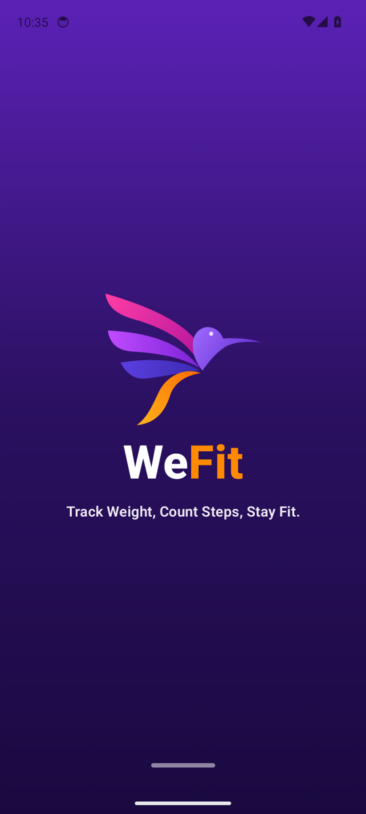
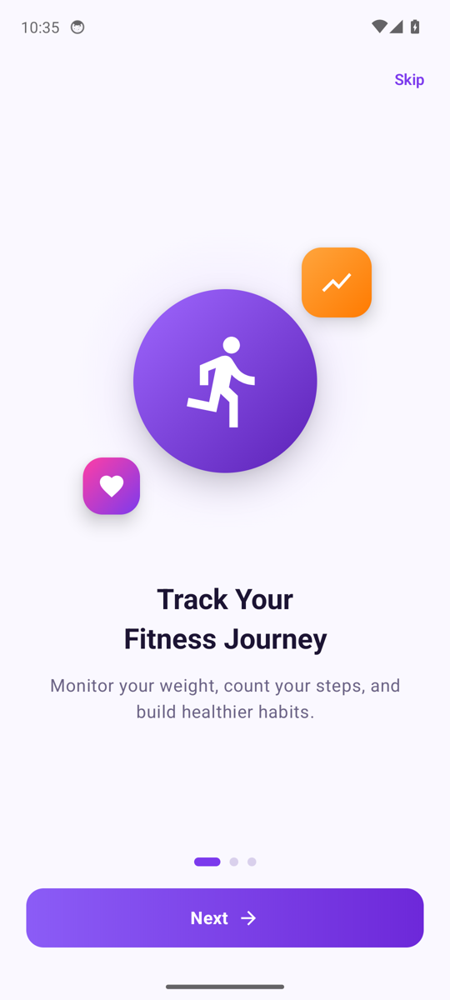
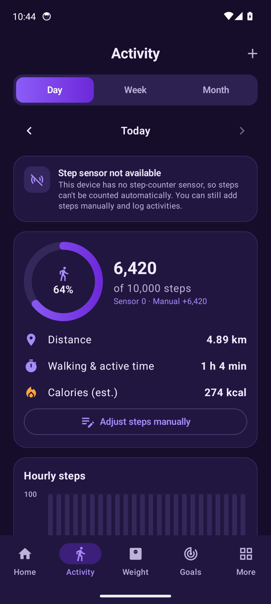
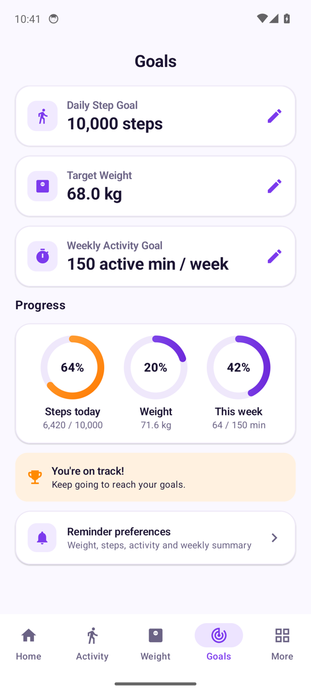
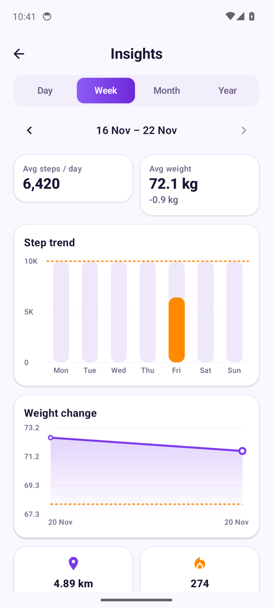
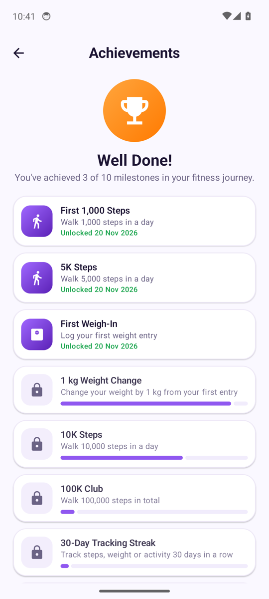
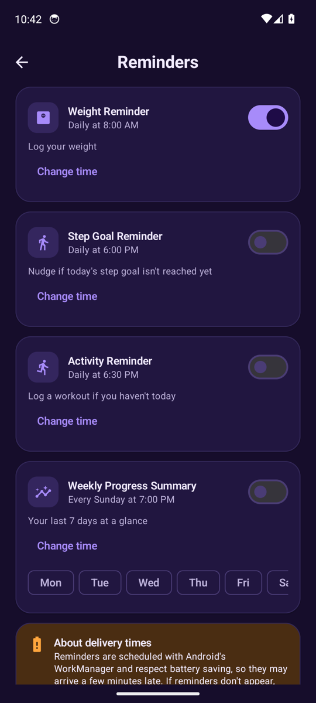
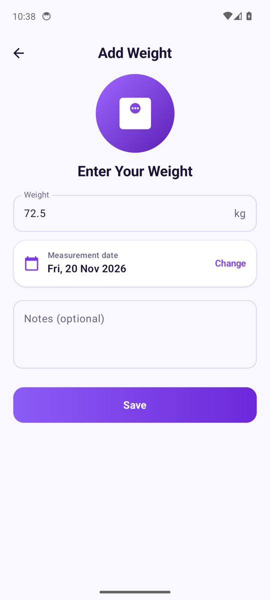

<p align="center">
  
</p>

<h1 align="center">WeFit</h1>

<p align="center">
  <b>Track weight, count steps, stay fit.</b><br/>
  A privacy-first, offline Android fitness tracker built with Kotlin and Jetpack Compose.
</p>

<p align="center">
  
  
  
  
</p>

---

WeFit counts your daily steps with your phone's built-in step sensor. It also tracks body weight, logs workouts, and turns all of that into goals, streaks, insights and achievements.

There is **no account, no backend, no ads and no internet permission**. Every byte of your data stays on your device.

## Table of contents

- [Screenshots](#screenshots)
- [Features](#features)
- [Getting started](#getting-started)
- [Architecture](#architecture)
- [How step counting works](#how-step-counting-works)
- [Testing](#testing)
- [Privacy](#privacy)
- [Contributing](#contributing)
- [Roadmap ideas](#roadmap-ideas)
- [License](#license)

## Screenshots

| Onboarding | Activity (dark) | Goals | Insights |
|:---:|:---:|:---:|:---:|
|  |  |  |  |

| Achievements | Reminders (dark) | Add weight | Splash |
|:---:|:---:|:---:|:---:|
|  |  |  |  |

## Features

- 🚶 **Automatic step counting.** Uses the hardware `TYPE_STEP_COUNTER` sensor. Handles app restarts, reboots and date changes without double counting. Includes an hourly chart, day / week / month history and goal streaks. Manual step adjustments are labelled separately from sensor steps.
- ⚖️ **Weight tracking.** Add, edit and delete entries with a date and notes. A progress chart with a target line, week / month / year / all filters, and start, current, target and total change. Supports kg and lb.
- 🏃 **Activity log.** Walking, running, cycling and other activities, with duration, optional distance and optional calories. Calories are estimated with MET values if you leave them blank. Walking and running entries never double count steps the sensor already recorded.
- 🎯 **Goals.** Daily steps, target weight and weekly active minutes, each with a progress ring.
- 📊 **Insights.** Day / week / month / year trends, comparison with the previous period, distance, calories, goal completion and streaks. Everything is computed from your own stored data.
- 🔔 **Reminders.** Weight, step goal (fires only if you're behind), activity (fires only if nothing is logged yet) and a weekly summary. Each has its own time and on/off switch.
- 🏆 **Achievements.** 10 milestones with progress bars, unlock dates and notifications.
- 🌗 **Light and dark themes**, metric and imperial units, and a layout that adapts to different screen sizes.
- 💾 **Your data, your files.** Export to CSV, back up and restore with a JSON file, or reset everything.

## Getting started

### Requirements

- Android Studio Ladybug or newer, *or* JDK 17 plus the Android SDK command-line tools
- Android SDK Platform 35
- A device or emulator running Android 10 (API 29) or later

> Emulators usually have **no step-counter sensor**. WeFit detects this and falls back to manual step entry. Use a real phone to try automatic counting.

### Build and run

```bash
git clone https://github.com/niraj-ghetiya/WeFit.git
cd WeFit

# Point Gradle at your SDK (Android Studio does this automatically)
echo "sdk.dir=$HOME/Library/Android/sdk" > local.properties

./gradlew assembleDebug     # APK: app/build/outputs/apk/debug/app-debug.apk
./gradlew installDebug      # install on a connected device
```

Or open the project in Android Studio and run the **app** configuration.

The debug build installs as `com.wefit.app.debug`, so it can sit alongside a release build.

### Release builds

Release builds are minified with R8. Sign them with your own keystore. Never commit keystores or passwords; `*.jks` and `keystore.properties` are already in `.gitignore`.

```bash
./gradlew assembleRelease   # app/build/outputs/apk/release/app-release-unsigned.apk
```

## Architecture

WeFit follows **MVVM with Clean Architecture layers**. Dependencies are wired with Hilt.

```
app/src/main/java/com/wefit/app
├── domain/          Pure Kotlin, no Android dependencies, fully unit-tested
│   ├── model/       UserProfile, WeightEntry, DailySteps, ActivityEntry, FitnessGoals …
│   ├── calc/        Fitness formulas, step-sensor logic, streaks, insights, achievements
│   └── repository/  Repository interfaces
├── data/
│   ├── local/       Room entities, DAOs, database, migrations
│   ├── preferences/ DataStore (theme, units, onboarding state)
│   ├── repository/  Repository implementations
│   └── backup/      CSV export, JSON backup and restore, reset
├── step/            Sensor source, tracker, periodic sync worker, foreground service, boot receiver
├── reminders/       WorkManager-based reminder scheduling
├── achievements/    Re-evaluates achievements whenever data changes
├── notifications/   Notification channels and helpers
├── di/              Hilt modules
└── ui/              Compose screens and ViewModels, theme, components, navigation
```

**Tech stack**

| Area | Libraries |
|---|---|
| UI | Jetpack Compose, Material 3, Navigation Compose, custom Canvas charts |
| State and DI | ViewModel with `StateFlow`, Kotlin coroutines and Flow, Hilt |
| Storage | Room 2.6 (schema exported to `app/schemas`), DataStore Preferences |
| Background work | WorkManager, an optional `health` foreground service |
| Serialization | kotlinx.serialization (backup files) |
| Tests | JUnit 4, Truth, Robolectric, Compose UI Test, AndroidX Test |

Screens observe Room and DataStore flows. Logging a weight or activity, or a new sensor reading arriving, updates the dashboard, charts and achievements automatically.

## How step counting works

`TYPE_STEP_COUNTER` reports the total number of steps since the device last booted. WeFit turns that running total into accurate daily records:

1. **Deltas only.** WeFit saves the last reading it processed and credits only the difference. This happens inside a single database transaction, so duplicate readings, app restarts or two listeners running at once never double count.
2. **Reboot detection.** If `Settings.Global.BOOT_COUNT` changes, or the counter goes backwards, WeFit treats it as a reboot and credits the steps taken since boot.
3. **Correct days and hours.** There is one record per calendar day. Steps from short intervals are split across the hours, and across midnight, that they span.
4. **Glitch protection.** Readings above 250 steps per minute are discarded.
5. **When syncing happens:**
   - live, while the app is open;
   - about every 15 minutes in the background through WorkManager;
   - right after a reboot;
   - continuously, if the user turns on **Background step tracking**. This is an opt-in foreground service with a visible notification.

**Known limitations** (also explained in the app):

- Nothing is counted while the phone is switched off.
- Steps taken between the last sync and a reboot can be lost.
- Android may delay background work to save battery.

**Manual activities and double counting.** Walking and running are already in your step count. For those types, WeFit uses the *higher* of the step-based estimate and the logged entry, instead of adding them together. Cycling and other activities are always added on top.

**Estimates.** All of these are labelled "est." in the UI:

- **Stride:** about 41.4% of height.
- **Walking calories:** 0.57 kcal per mile per lb of body weight.
- **Activity calories:** MET × kg × hours.

## Testing

```bash
./gradlew testDebugUnitTest                                  # JVM + Robolectric tests
adb shell pm clear com.wefit.app.debug                       # instrumented tests expect a fresh install
./gradlew connectedDebugAndroidTest                          # end-to-end tests on a device or emulator
```

| Suite | What it covers |
|---|---|
| `test/.../domain` | Fitness formulas, unit conversions, double-counting rules, step deltas and reboots, hourly and midnight allocation, streaks, insights, achievements, reminder timing, validators |
| `test/.../data` | Repositories on in-memory Room: sensor pipeline, duplicate prevention, weight CRUD, idempotent achievement unlocks, backup round trip, invalid backups, CSV export |
| `test/.../ui` | Compose UI tests for onboarding, profile setup, the add weight and add activity forms, and step adjustment |
| `androidTest` | End-to-end: onboarding → profile setup → dashboard → add weight → log activity on the real database |

## Privacy

- All data lives in WeFit's private storage on your device. There are no servers, no analytics, no ad SDKs and no internet permission.
- Android cloud backup is disabled. Exports and backups go only where *you* choose to save them.
- **Permissions requested:**
  - Physical activity, to read the step sensor.
  - Notifications, only when you turn on a reminder.
  - Foreground service (health), only if you turn on background tracking.
  - Run at startup, to resume tracking after a reboot.
- *Settings → Reset application data* permanently erases everything, and so does uninstalling.

## Contributing

Contributions are welcome! Bug reports, feature ideas, translations, design tweaks and code are all appreciated.

1. **Open an issue** to describe the bug or proposal before starting larger changes.
2. **Fork** the repository and create a branch: `git checkout -b feature/my-change`.
3. **Follow the existing structure.**
   - Put pure logic in `domain/calc`, with unit tests.
   - Keep Android code in the `data`, `step` and `ui` layers.
   - Use the reusable Compose components in `ui/components`.
4. **Keep it private and offline.** Pull requests must not add network access, analytics, ads or account requirements.
5. **Database changes.** Bump the Room version and add a `Migration` in `WeFitMigrations`. Destructive migrations are not accepted.
6. **Run the tests** with `./gradlew testDebugUnitTest` and make sure the project builds before opening a pull request.
7. Open a **pull request** that describes what changed and why. Add screenshots for UI changes.

Please be respectful and constructive in issues and reviews.

## Roadmap ideas

Good first contributions:

- [ ] Home-screen widget showing today's steps
- [ ] Health Connect import and export (opt-in)
- [ ] Localization (strings are ready to be moved into resources)
- [ ] Water intake tracking
- [ ] Tablet and foldable layouts
- [ ] Room migration tests once the schema reaches version 2

## License

WeFit is released under the [MIT License](LICENSE).

The WeFit name and hummingbird logo are part of this project's branding. If you publish a fork to an app store, please use your own name and icon.
